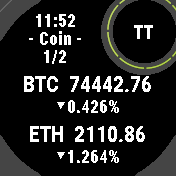
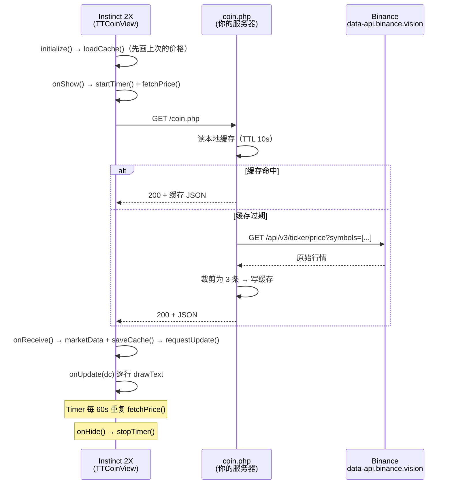

# TTCoin

> 在 Garmin Instinct 2X 上随手看一眼币价。一个 Connect IQ **Watch App**：从应用列表进入，带选币/排序菜单与 24h 涨跌。




上方就是手表上的实际画面（176×176 原图，未做任何修饰）：顶部时间与页号，
下面是 BTC / ETH 的价格与 24h 涨跌幅，向下翻页看其余已勾选的币种。

> **装上表之前**：接口地址默认是占位地址 `https://your-domain.example/coin.php`。
> 先用 [`TTCoin_API`](https://github.com/hh1949tt/TTCoin_API/blob/main/README.md) 部署自己的中转接口，再按
> [配置接口地址](#2-配置接口地址) 改成你自己的地址，否则只会显示 `- Offline -`。
>
> **许可**：PolyForm Noncommercial 1.0.0 —— **仅限非商业用途**，详见 [LICENSE](LICENSE)。

### 四个仓库

| 形态 | 仓库 |
| --- | --- |
| 表盘（Watch Face） | <https://github.com/hh1949tt/TTCoin_WF> |
| Watch App | <https://github.com/hh1949tt/TTCoin_APP> |
| Widget | <https://github.com/hh1949tt/TTCoin_Widget> |
| 服务端中转 | <https://github.com/hh1949tt/TTCoin_API> |

三个表端项目共用同一套接口约定（`[{symbol,base,price,change}]`），
服务端可任选 PHP 或 Cloudflare Worker 版。

```
        TT
      - Coin -
  BTC: 75701.02
  ETH: 2235.51
  DOGE: 0.0716
```

---

## 目录

- [这是什么](#这是什么)
- [功能特性](#功能特性)
- [工作原理](#工作原理)
- [目录结构](#目录结构)
- [环境要求](#环境要求)
- [快速开始](#快速开始)
- [服务端（TTCoin_API）](#服务端ttcoin_api)
- [自定义配置](#自定义配置)
- [多语言](#多语言)
- [屏幕可绘区域（Instinct 2X）](#屏幕可绘区域instinct-2x)
- [已知限制](#已知限制)
- [常见问题](#常见问题)
- [参与贡献](#参与贡献)
- [免责声明](#免责声明)
- [English](#english)

---

## 这是什么

`TTCoin` 是一个 Garmin Connect IQ **Watch App**（手表应用）。从应用列表启动，即可看到行情价格与 24 小时涨跌，每分钟自动刷新；交易对超过一屏时自动轮播，也支持按键手动翻页。

**在手表上就能配置**：按 Start 键呼出菜单，勾选显示哪些币种、调整显示顺序。

> ⚠️ **接口地址不支持在手表上修改**（原菜单里的 `TextPicker` 输入项已于 2026-11 移除）。地址由编译期的 `resources/properties.xml` `apiUrl` 决定，商店安装的版本也可以在手机端 Garmin Connect 的应用设置里改。

> ⚠️ **用数据线侧载安装时，Garmin Connect 里看不到这个应用的设置页**。手机端的 Connect IQ 设置只对「从 Connect IQ 商店安装」的应用渲染，侧载的 `.prg` 不在账号的应用列表里（截图里「我的应用」只有商店应用就是这个原因）。侧载用户要换地址，改 `properties.xml` 后重新编译；如果一定要在手机上改，得把应用上传成 Connect IQ 的 **Beta App**。

行情来自 Binance 公共行情接口，但手表**不直连** Binance，而是经由一个自建的 PHP 中转脚本。这么做有两个原因：

1. Garmin 设备端只支持 HTTPS + 标准 JSON，自己中转一层可以把 Binance 的原始响应裁剪成极小的 3 条记录（约 100 字节），省电省流量；
2. 手表端 TLS 握手机制、DNS 和证书链对目标站点的兼容性有限，中转层可以把不稳定性挡在服务端。

> ⚠️ **重要**：仓库里的默认接口地址是占位符 `https://your-domain.example/coin.php`，直接装上是拿不到行情的。请按 [`../TTCoin_API/README.md`](https://github.com/hh1949tt/TTCoin_API/blob/main/README.md) 部署自己的中转接口，再改 `resources/properties.xml` 的 `apiUrl`（或在手机端设置里填）后重新编译。

## 功能特性

| 特性          | 说明                                                                                         |
| ----------- | ------------------------------------------------------------------------------------------ |
| 顶部时钟        | 副标题正上方显示当前时间（24 小时制 `14:25`），与 `- Coin -` 共用同一条垂直轴；1 秒一拍但**只在换分钟时重绘**，`onHide` 立刻停表 |
| 灯孔 TT 标       | 右上角手电筒灯孔里常驻 `TT` 标记，与行情无关，任何状态下都显示                                                  |
| 涨跌指示        | 每个币种下方显示 24 小时涨跌幅：`▲2.3%` / `▼1.1%`（单色 MIP 屏不靠颜色；三角形是 `fillPolygon` 手绘的，见下文）                        |
| 手表端选币       | Start 键 → 菜单勾选显示哪些交易对，立即生效并持久化                                                          |
| 手表端排序       | 菜单里对已启用币种上移 / 下移                                                                        |
| 界面双语        | 菜单文案走资源表：中文固件显示中文，英文固件显示英文，同一份 `.prg` 通吃（见[多语言](#多语言)）                                        |
| 手机端设置       | 仅**商店安装**的版本可用：Garmin Connect 应用设置（`settings.xml`）勾选币种、改接口地址；侧载安装看不到这一页                |
| 多币种轮播       | 默认每屏 2 个币种；超过 2 个时每 8 秒自动翻页，页码单独一行显示在副标题下方（`- Coin -` / `1/2`）                         |
| 手动翻页        | Up / Down 键翻页，Start 呼出菜单，Back 退出                                                         |
| 自动刷新        | 进入应用即刷新，之后 `Timer` 分频轮询：约每 64 秒拉取一次（轮播与抓取共用一个定时器）                                       |
| 离线降级        | 网络失败时显示上次缓存的价格与涨跌，副标题变为 `- Offline -`                                                    |
| 状态可见        | 六种提示各对应一种情形：`Loading...` / `- Coin -` / `- Cache -` / `- Offline -` / `No Net` / `No Data` |
| 极简协议        | 服务端返回定长 JSON 数组，客户端零解析成本                                                                   |
| 服务端缓存       | 文件缓存（TTL 10s）+ 上游失败时回退旧值，避免手表拿到 5xx                                                        |
| 本地缓存        | 价格写入 `Application.Storage`，冷启动也能秒出数据                                                       |
| 纯 Canvas 绘制 | 不用 layout XML，直接 `drawText` 定位，省内存                                                         |
| 低功耗         | 单页 View，无动画、无后台服务、无 Sensor；行情轮询与时钟两个 `Timer` 都在 `onHide` 立即停表，时钟还只在换分钟时才重绘                    |

## 工作原理



关键代码路径：

| 文件                     | 职责                                              |
| ---------------------- | ----------------------------------------------- |
| `source/TTCoinApp.mc`  | `AppBase` 入口，`getInitialView()` 返回 `TTCoinView` |
| `source/TTCoinView.mc` | 全部业务：发请求、本地缓存、状态机、定时器、绘制                        |
| `../TTCoin_API/coin.php` | 手表调用的主接口，带缓存与降级（服务端独立目录）                 |

## 目录结构

```
TTCoin/
├── manifest.xml                 # Connect IQ 应用清单（id / 类型 / 设备 / 权限 / 语言）
├── monkey.jungle                # 构建配置，指向 manifest.xml
├── source/
│   ├── TTCoinApp.mc             # 应用入口（返回 [View, Delegate]）
│   ├── TTCoinView.mc            # 主视图：绘制 + 网络 + 定时器 + 选币/排序配置
│   ├── TTCoinDelegate.mc        # 按键代理：Start=菜单，Up/Down=翻页
│   ├── TTCoinMenu.mc            # 设置菜单：选币 / 排序（接口地址不再支持表端修改）
│   └── TTCoinText.mc            # 菜单文案取用入口（资源化，中英双语）
├── resources/
│   ├── drawables/
│   │   ├── drawables.xml
│   │   └── launcher_icon.png    # 62×62 启动图标
│   ├── strings/strings.xml      # 基础语言（英文）：AppName + 菜单文案
│   ├── properties.xml           # 币种开关默认值（手机端设置的数据源）
│   └── settings.xml             # 手机端应用设置界面定义
├── resources-zhs/
│   └── strings/strings.xml      # 简体中文文案（id 与基础语言一一对应）
├── docs/
│   └── CODE_REVIEW.md           # 代码审查与改进建议
├── .vscode/launch.json          # Monkey C 调试配置
└── bin/                         # 构建产物（已在 .gitignore 中忽略）
```

## 环境要求

**手表端**

- Garmin Instinct 2X（`instinct2x`）。其他机型需在 `manifest.xml` 的 `<iq:products>` 中追加对应 product id，并自行核对屏幕尺寸与坐标。
- Connect IQ **System API 3.4.0** 及以上（`FONT_GLANCE_NUMBER` 依赖此级别）。

**开发端**

- [Connect IQ SDK](https://developer.garmin.com/connect-iq/sdk/)（建议 6.x 或更新）
- [Visual Studio Code](https://code.visualstudio.com/) + 官方扩展 **Monkey C**
- 一个 Garmin 开发者签名密钥（`.der`），用于真机安装

**服务端**（详见 [`../TTCoin_API/README.md`](https://github.com/hh1949tt/TTCoin_API/blob/main/README.md)）

- PHP 7.4+，启用 `curl` 与 `json` 扩展；任意支持 HTTPS 的 Web 服务器

## 快速开始

### 1. 克隆并打开

```bash
git clone https://github.com/hh1949tt/TTCoin_APP.git
cd TTCoin
code .
```

### 2. 配置接口地址

接口地址**只能在编译期或手机端设置**，手表菜单里没有修改入口（2026-11 移除）：

**① 改编译默认值（侧载安装必用）**：编辑 `resources/properties.xml` 后重新编译：

```xml
<property id="apiUrl" type="string">https://your-domain.example/coin.php</property>
```

**② 手机端改（仅从 Connect IQ 商店 / Beta App 安装的版本）**

Garmin Connect → 设备 → Connect IQ 应用 → TTCoin → 设置 → 「行情接口地址」。

> ⚠️ 用数据线把 `.prg` 拷进 `GARMIN\APPS` 的安装方式**不会**在 Garmin Connect 的「我的应用」里出现，所以看不到第 ② 种入口——这是 Garmin 的设计（设置界面由账号里的商店应用驱动），不是应用本身的问题。要在手机上改，把应用上传成 **Beta App** 即可（`manifest.xml` 换一个 UUID 的 app id，Connect IQ 后台勾选 Beta 上传，本账号内可下载，设置页随即出现）。

地址校验统一在客户端做：不是 `https://` 开头、或长度不足，一律回退到编译期默认值 `DEFAULT_API`（`makeWebRequest` 在多数设备上只接受 HTTPS）。

### 2.5 行情配置 ID（自动生成，可选手动覆盖）

设置里还有一项「行情配置 ID」（`properties.xml` 的 `faceId`，限字母数字、
最长 32）。**留空时客户端自动生成设备 ID**：`TC` +
`System.getDeviceSettings().uniqueIdentifier`（限长 32，同设备恒定、卸载
重装不变），随请求带 `?id=`，不用再手动抄 ID。服务端按 `TTCOIN_FACE_IDS`
里登记的覆盖默认行情（滚屏 / 固定 / 顺序 / 条数 / **主币种**，写哪个覆盖
哪个），没登记的 id 走默认一套（默认币种）。想查自己设备的 id：看服务端
响应头 `X-TTCoin-Face-Id`，或服务端访问日志里的 `?id=`。手动填了非空 id
则优先用手动的——**表盘（TTCoin_WF）/ 本 APP / Widget 三个客户端逻辑
一致**：同设备的自动 id 相同语义，登记后三端看到同一套行情，各 id 的币种
也可以不一致。配置格式见 [`../TTCoin_API/README.md`](https://github.com/hh1949tt/TTCoin_API/blob/main/README.md)
的「按 ID 覆盖」一节。

### 3. 编译

VS Code 中按 `F5`（选择 **Run App**），或在终端手动执行：

```bash
# 生成 .prg（需要开发者密钥，没有 -y 只能编译出模拟器包）
monkeyc -f monkey.jungle -d instinct2x -o bin/TTCoin.prg -y /path/to/developer_key.der

# 安装到已连接的手表
monkeydo bin/TTCoin.prg instinct2x
```

> 密钥在 [Garmin Developer 门户](https://developer.garmin.com/connect-iq/) 的 *Manage Keys* 中生成，生成时导出的 `.der` 文件请勿提交到仓库。

### 4. 在手表上打开

长按 `MENU` → 进入小工具列表 → 找到 **TTCoin**。首次进入会显示 `Loading...`，联网成功后即出现价格。

## 服务端（TTCoin_API）

服务端代码已独立到同级目录 **`TTCoin_API`**（原 `api/` 目录），与表端解耦，三个形态共用同一份：

| 文件 | 职责 |
| --- | --- |
| `coin.php` | 手表调用的主接口，带缓存与降级，按设备记请求日志 |
| `update_price.php` | cron 预热脚本 |
| `lib.php` | 抓取 / 校验 / 缓存 / 请求日志（共用依赖） |

手表调用的接口约定（`?uid=` / `?type=` 参数、请求日志格式、小数位规则、502 降级行为）全部移至 [`../TTCoin_API/README.md`](https://github.com/hh1949tt/TTCoin_API/blob/main/README.md)，请到那边查阅。后端部署（上传、缓存/日志目录、cron 预热、安全建议）也在同一份文档里。

## 自定义配置

| 想改什么  | 改哪里                                                                 | 说明                                    |
| ----- | ------------------------------------------------------------------- | ------------------------------------- |
| 接口地址  | `resources/properties.xml` `apiUrl`（或手机端设置）             | 必须以 `https://` 开头；非法值回退 `DEFAULT_API`；**不支持手表端修改** |
| 轮播间隔  | `source/TTCoinView.mc` `PAGE_MS`                                     | 单位毫秒，默认 8000；每页停留时长                   |
| 抓取周期  | `source/TTCoinView.mc` `FETCH_TICKS`                                 | 每 N 拍抓一次行情（8 拍 × 8s ≈ 64s）            |
| 每屏行数  | `source/TTCoinView.mc` `PAGE_ROWS`                                   | 默认 2；176px 高被手电筒外圈切掉一截，最多只放得下 2 组（每组两行） |
| 行间距   | `source/TTCoinView.mc` `BLOCK_PITCH` / `CONTENT_TOP`                 | 参考值 50 / 69（176 基准）；实际按屏幕高度等比例缩放            |
| 标题位置  | `source/TTCoinView.mc` `TITLE_CX` / `TITLE_Y`                        | 默认 55 / 26；水平居中于左上斜边与灯孔之间（见"屏幕可绘区域"）      |
| 币种列表  | `TTCoin_API/lib.php` 的 `ttcoin_symbols()`                                   | **只改这一处**，输出顺序 = 数组顺序                |
| 小数位上限 | `TTCoin_API/lib.php` 的 `TTCOIN_MAX_DECIMALS`                                | 默认 4；上游位数超过它才四舍五入                      |
| 缓存时长  | `TTCoin_API/lib.php` 的 `TTCOIN_CACHE_TTL`                                   | 单位秒，默认 10；建议 <= cron 间隔               |
| 数据源   | `TTCoin_API/lib.php` 的 `TTCOIN_API_URL`                                     | 换交易所需同步改 `ttcoin_fetch()` 的解析字段          |
| 应用名   | `resources/strings/strings.xml`                                     | 同时影响启动器显示；中文名改 `resources-zhs/strings/strings.xml` 的同名 id |
| 支持机型  | `manifest.xml` 的 `<iq:products>`                                    | 需自行适配坐标与字号                            |

## 多语言

菜单文案（`Coins` / `Reorder` / `Move Up` / `Move Down` 等）不写在源码里，走 Connect IQ 的资源限定符：

```
resources/strings/strings.xml        基础语言 = 英文（任何未翻译的语言都落这里）
resources-zhs/strings/strings.xml    简体中文
```

- 运行时按**设备系统语言**选：手表是中文 → 中文文案；英文或其它语言 → 英文文案。同一个 `.prg` 两种固件都能用，不需要编译两份。
- 代码里统一用 `TTCoinText.get(Rez.Strings.Xxx, "英文兜底")` 取（`source/TTCoinText.mc`）。资源取不到时返回兜底串，不会因为 `null` 在 strict 模式下抛错。
- `manifest.xml` 的 `<iq:languages>` 只是商店侧「支持语言」元数据，**不影响运行时选择**；运行时只看资源目录后缀。

**为什么英文那份必须是纯 ASCII**：Instinct 2X 有两个固件 SKU，国际版（Part `006-B4394-00`）字体只有 Roboto，没有中文字形；中文版才有 `Noto Sans SC`。把中文留在基础语言里，国际版固件上就是一片缺字方块（1.0.0 的实测截图见 `docs/shots/app-menu-tofu.png`）。

**为什么菜单里没有 ↑ / ↓**：Garmin 内建字体同样没有 `U+2191` / `U+2193`，运行时画成空心菱形，两个条目看起来一样。菜单只能画文字、没法像行情箭头那样 `fillPolygon`，所以直接用「上移 / 下移」「Move Up / Move Down」。行情页的涨跌三角是手绘的，不受字体影响。

需要加新文案时：两个 xml 加**同名 id**，缺一条只会静默回落英文，不会编译报错。

## 屏幕可绘区域（Instinct 2X）

Instinct 2X 的屏幕是 176×176，但**能画的像素远小于这个矩形**。SDK 自带的界面参考文件
`resources/device-reference/instinct2x/layout0.svg` 里给出的遮罩是这个形状：

```svg
<!-- 八边形：四角各切掉 39.6px -->
<path d="M 39.6,0 L 136.4,0 L 176,39.6 L 176,136.4 L 136.4,176 L 39.6,176 L 0,136.4 L 0,39.6 Z"/>
<!-- 右上角手电筒挖孔：圆心 (144,31)，半径 31 -->
<circle cx="144" cy="31" r="31"/>
```

也就是说：

- 左上斜边满足 `x + y = 39.6`，贴边越近越容易被切；
- 右上角 `(144, 31)` 那圈是手电筒灯孔：**灯孔内部是可以画的**（`TT` 标就放在这里），被吃掉的是它外面那圈约 6px 宽的金属环——实测环带在 `x 107..113`、下沿到 `y≈68`；
- 所以**整行宽的内容从 `y=76` 起排**，标题和页码挤进「左斜边 → 灯孔左沿」那段空档（`x 2..107`，左右居中于 `x=55`）。

`source/TTCoinView.mc` 里与之对应的常量：

| 常量 | 值 | 含义 |
| --- | --- | --- |
| `TITLE_CX` / `TITLE_Y` | 55 / 26 | 副标题的水平中心与 cell 顶部（字面落在 y≈31..44） |
| `PAGE_DY` | 18 | 页码行相对副标题的下移量；页码单独一行（字面 y≈50..62） |
| `BADGE_CX` / `BADGE_CY` | 144 / 31 | 灯孔里 `TT` 标的中心（与灯孔几何中心重合） |
| `CONTENT_TOP` | 69 | 第一组价格 cell 顶部（字面落在 y≈76..91） |
| `PRICE_TO_CHANGE` | 25 | 价格行 → 涨跌行的偏移；字体 cell 自带留白，两行**负重叠**排，字面间留 8px |
| `BLOCK_PITCH` | 50 | 每组（价格 + 涨跌）占 50px：组内 8px、组间 13px，2 组共 100px |

改这些值之后务必真机/模拟器截图确认三件事：第一行价格尾部不被圆吃掉、最后一行涨跌不被下边缘切掉、标题不越出斜边。

## 已知限制

1. **侧载安装没有手机端设置页。** 用数据线把 `.prg` 拷进 `GARMIN\APPS` 时，Garmin Connect 的「我的应用」里不会出现 TTCoin，`settings.xml` 定义的设置界面也就不会渲染。手表菜单覆盖选币、排序两件事；接口地址不支持手表端修改（原 `TextPicker` 输入项已移除），要改就改 `properties.xml` 重新编译，或走 Connect IQ 商店 / Beta App。
2. **只做了 Instinct 2X 的屏幕形状适配。** 布局按 176×176 设计并随屏幕宽高等比例缩放，但没有处理其他机型的挖孔/圆角——换机型需要重新核对"屏幕可绘区域"。
3. **需要手动启动。** Watch App 不再出现在小工具循环里，要从应用列表启动（可加到收藏/快捷方式）。换来的是按键输入、菜单配置和前台常驻。
4. **缓存不区分新旧。** 缓存没有过期判断，隔几天再打开也会先显示旧价，只能靠副标题 `- Cache -` / `- Offline -` 提醒。
5. **一屏最多 2 个币种。** 手电筒灯环吃掉右上角后，能放整行宽文本的只剩 `y 76..162`；价格 16px + 可读的涨跌 13px 再加组内外间距，两组就是 87px，第三组放不下。更多币种靠 8 秒轮播 + Up/Down 手动翻页。
6. **单一数据源。** 只接 Binance，未做多源容灾。
7. 更多问题见 [`docs/CODE_REVIEW.md`](docs/CODE_REVIEW.md)。

## 常见问题

**Q: 屏幕上这些提示分别代表什么？**

| 显示            | 含义                 | 下一步                         |
| ------------- | ------------------ | --------------------------- |
| `Loading...`  | 首次进入，还没有任何数据       | 等 2~3 秒；长时间不变看下一问           |
| `- Coin -`    | 实时数据，正常状态          | 无需处理                        |
| `- Cache -`   | 显示的是本地缓存，本轮请求还在路上  | 正常几秒内会变成 `- Coin -`；一直不变见下一问 |
| `- Offline -` | 请求失败，正在显示上次成功抓到的价格 | 检查手机网络 / 接口是否可用             |
| `- Offline 403 -` | 同上，末尾数字是 SDK 返回的响应码 | 403 / 503 多为 CDN 或防火墙拒绝；负数是连不上 |
| `No Net`      | 请求失败，且本地没有任何缓存     | 同上                          |
| `No Net 403`  | 同上，带响应码              | 同上                          |
| `- Offline -1 -` / `No Net -1` | 本机等超时：45 秒没收到回调 | 看手机网络；`-1` 是本机合成码，不是 SDK 返回的 |
| `No Data`     | 拿到响应但结构不对          | 检查 `coin.php` 返回是否是 JSON 数组 |

> 失败时副标题（或 `No Net` 后面）会带上 SDK 给的响应码，用来区分「连不上」（负数，如 `-104`）、「服务端 / CDN 拒绝」（`403` / `503`）和「返回体不是 JSON 数组」（`200`）。码为 `0` 表示 SDK 没给，按原样只显示 `- Offline -`。

**Q: 一直显示 `Loading...` 或 `No Net`**

按顺序排查：

1. 接口地址是否为 HTTPS，且域名证书有效（自签证书不行）——核对 `properties.xml` 的 `apiUrl`（商店安装的版本看手机端设置里显示的那条）；
2. `manifest.xml` 是否包含 `Communications` 权限（本仓库已含）；
3. 手机端 Garmin Connect 是否在线——**手表的网络请求实际上经由手机转发**，手机断网则必然失败；
4. 用手机浏览器打开同一个 URL，确认返回的是 JSON 而不是 PHP 源码或 500 页面；
5. 看屏幕上的响应码：`403` 且域名在 Cloudflare 后面时，多半是 WAF / 机器人校验拦了非浏览器客户端，给该子域名关掉代理（DNS only）或加放行规则；负数则检查 DNS 与线路。
6. **地址读的是属性 `apiUrl`**：属性值会跨安装保留，早期版本从手表菜单存过的旧地址会一直覆盖 `properties.xml`。新版已加自动回退——失败一次后会用编译期 `DEFAULT_API` 重试，两次都失败才报错。

**Q: 价格太长显示不下 / 文字被右上角挡住了一块**

- **被右上角挡住**：那是手电筒挖孔（见[屏幕可绘区域](#屏幕可绘区域instinct-2x)），把内容排到 `y>64` 即可，别往上顶；
- **太长放不下**：`choosePriceFont()` 会自动在 `FONT_MEDIUM → FONT_SMALL → FONT_TINY` 里选一档整页都能放下的字号，不会溢出屏幕。想强制固定字号，把 `choosePriceFont()` 的返回值改成常量即可。

**Q: 涨跌前面那个小三角看着像空心菱形**

旧版本直接用 `"▲"` / `"▼"` 字符，而 Garmin 内置字体里没有这两个码位，运行时会渲染成"缺字占位符"（空心菱形）。现在改成 `dc.fillPolygon()` 手绘三角形，不依赖字体，任何机型都不会缺字。

**Q: 价格不更新**

App 在**每次启动时**（`onShow`）都会请求一次，之后定时器每约 64 秒再补一次。App 在前台可以一直停留，轮播和定时刷新都能持续工作——这是改成 Watch App 后相对 Widget 最大的体验提升。若长期不变，检查服务端缓存文件（默认 `../cache/coin.json`）的 `filemtime` 是否在更新（服务端缓存 TTL 为 10 秒，也可能正好命中）。

若副标题是 `- Cache -` 或 `- Offline -`，说明显示的是旧数据，不是没更新。

**Q: 和小工具版都装了，但手表上只剩一个**

两个项目的 `manifest.xml` 用了同一个 `iq:application@id`。Connect IQ 按 id 认应用，同一块表上同一 id 只能有一条记录，后装的会顶掉先装的（连 `type` 一起改），所以装完 Widget 后 App 列表里就找不到本应用了。

两边 id 现已分开：本项目 `1d087cf1-27ae-4c64-a653-42e113497d07`（`watch-app`，应用列表里叫 **TTCoin**），`TTCoin_Widget` 用 `e8dab0f9-d9a8-4ef5-8bab-fd05bcf135f5`（`widget`，小工具列表里叫 **TTCoin Widget**）。踩过坑的表先删掉旧条目再分别安装。细节见 [`../TTCoin_Widget/docs/CODE_REVIEW.md`](https://github.com/hh1949tt/TTCoin_Widget/blob/main/docs/CODE_REVIEW.md) 第十一节。

**Q: VS Code 报 `Workspace not found.` / `Connect IQ project not found.`**

工作区根目录不是工程根目录。Monkey C 扩展是以**工作区根目录**去找 `monkey.jungle` 和 `manifest.xml` 的：把 `TTCoin_APP`、`TTCoin_Widget`、`TTCoin_API` 放进同一个父文件夹、然后打开父文件夹，父目录里没有 jungle，就会同时报这两条。

解决：`文件 → 打开文件夹` 直接选 `TTCoin_APP`（或 `TTCoin_Widget`）本身，一个工程一个窗口。`TTCoin_API` 是 PHP 服务端，本来就没有 jungle，在它里面报这个错是正常的。

**Q: VS Code 报 `t.split is not a function`（Monkey C 扩展直接激活失败）**

`monkeyC.jungleFiles` 的类型是**分号分隔的字符串**（默认 `"monkey.jungle"`），不是数组。写成 `["monkey.jungle"]` 会让扩展在 `jungleFiles.split(";")` 处抛错，进而整个扩展挂掉——连带表现出"Workspace not found"之类的假象。多个 jungle 要写成 `"monkey.jungle;barrels.jungle"`。本仓库的 `.vscode/settings.json` 已经是正确写法，直接照抄即可。

**Q: 能不能改成 A 股 / 汇率 / 黄金？**

加一个**候选**币种，正常情况下**只需要改服务端一处**——手表端的候选列表、默认顺序、默认显示前 3 个，全都跟着接口返回走：

| 位置 | 是否必改 | 作用 |
| --- | --- | --- |
| `TTCoin_API/lib.php` 的 `ttcoin_symbols()` | **必改** | 服务端候选池（Binance 符号 → 简称），也是顺序的唯一真相 |
| `resources/properties.xml` | 可选 | 加一行 `enabledXXX` 默认值，手机端设置里才会出现这个开关；不加也能正常显示（属性缺失按未启用处理） |
| `resources/settings.xml` | 可选 | 手机端设置界面那一行勾选框，跟 properties 配套 |
| `source/TTCoinView.mc` 的 `COINS` | 可选 | 只在"首次启动 + 没网 + 没缓存"时用来撑设置菜单的兜底表，建议同步，不影响正常运行 |

默认行为：**没动过任何勾选 → 显示接口顺序的前 3 个**（服务端调整顺序或加币种，表上跟着变）；动过任意一项 → 完全按勾选来。显示顺序：没排过 → 接口顺序；排过 → 用排过的（Start 菜单 →「排序币种」）。

改完后：手表 Start 菜单（或手机端设置）勾选新币种即可显示；**超过 2 个**自动按页轮播（8 秒/页），Up/Down 键也可以手动翻。

## 参与贡献

欢迎 Issue / PR。提交前请确认：

1. 本地能编译通过（`monkeyc -f monkey.jungle -d instinct2x -o bin/TTCoin.prg`）；
2. 不要在代码中提交自己的私有接口地址或密钥；
3. 改动坐标/字号时附上真机截图。

## 免责声明

- 本项目仅用于个人学习与自用，行情数据来自第三方公开接口，**不保证准确性、实时性与可用性**；
- 所有价格仅供参考，**不构成任何投资建议**；
- 请遵守 Binance 及各数据提供方的服务条款，不要高频抓取；
- 因使用本项目产生的任何直接或间接损失，作者不承担责任。

## English

**TTCoin** is a [Garmin Connect IQ](https://developer.garmin.com/connect-iq/) **watch app** for the **Instinct 2X** that shows crypto prices and 24h change on your wrist. Launch it from the app list; Start opens a menu to pick and sort coins, Up/Down flips pages, and the widget-style version lives in the sibling `TTCoin_Widget` project.

The watch never talks to Binance directly — it calls a small PHP relay (`coin.php` in the sibling `TTCoin_API` directory) that trims the upstream 24h ticker response down to `{symbol, price, change}` records, caches it to a file, and falls back to the last good value when the exchange is unreachable. On the watch: Start opens a menu to pick/sort coins, Up/Down flip pages.

**Quick start**

```bash
git clone https://github.com/hh1949tt/TTCoin_APP.git
# 1. set your own HTTPS endpoint in resources/properties.xml (apiUrl), or later in Garmin Connect app settings
# 2. build & install
monkeyc -f monkey.jungle -d instinct2x -o bin/TTCoin.prg -y /path/to/developer_key.der
monkeydo bin/TTCoin.prg instinct2x
```

**Backend**: the PHP relay lives in the sibling `TTCoin_API` directory — upload its files (`coin.php`, `update_price.php`, `lib.php`, `.htaccess`) to any PHP 7.4+ host with `curl` enabled and HTTPS. See `TTCoin_API/README.md`. Verify with `curl -s https://your-domain.example/coin.php`.

**API contract**: `GET /coin.php` → `[{"symbol":"BTC","base":"BTC","price":"75701.02","change":"2.3"}, ...]` for all candidate pairs. `price` / `change` are **strings** following the upstream's actual decimal places (rounded to 4 only when longer), so the app just prints them. Tiny prices are scaled up server-side and carry the factor in the display name (`"symbol":"1000*SHIB"`), while `base` keeps the original short name — the coin menu and the local cache match on `base`, never on `symbol`. HTTP 502 on total failure. See the API contract section in `TTCoin_API/README.md`.

**Requirements**: Connect IQ SDK, Monkey C VS Code extension, System API 3.4.0+, a Garmin developer key for on-device install.

**Status**: personal hobby project, no support guarantee. Prices are informational only and not investment advice.

## License

以 [PolyForm Noncommercial License 1.0.0](LICENSE) 发布，**仅限非商业用途**。版权归 `TTCoin contributors` 所有。

| 可以 | 不可以 |
| --- | --- |
| 个人学习、研究、自用、改着玩 | **任何商业用途**：卖给客户、随硬件捆绑销售、公司内部业务系统、做成付费服务或订阅 |
| 学校、慈善、政府、公共研究等非商业组织使用 | 拿本项目提供有偿技术支持、代部署或托管服务 |
| 修改、二次开发、分发副本（须保留许可证与版权声明，并注明改动） | 删掉版权与许可证声明后当自己的作品发布 |

一句话区分：**能看到源码 ≠ 可以商用**。这是 source-available，不是 OSI 认可的开源许可证。

需要商用授权，到 [Issues](https://github.com/hh1949tt/TTCoin_APP/issues) 说明用途即可。软件按"现状"提供，不含任何担保。

This project is licensed under the PolyForm Noncommercial License 1.0.0.
**Commercial use of any kind requires a separate written license.**
