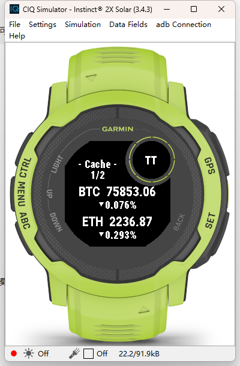
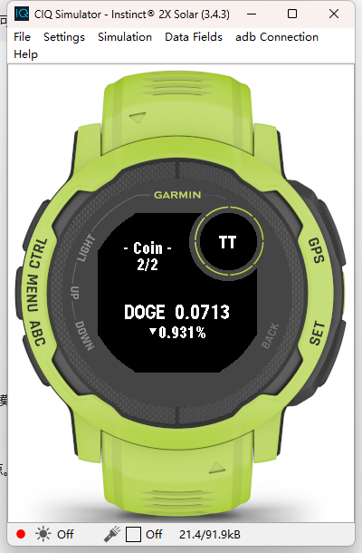
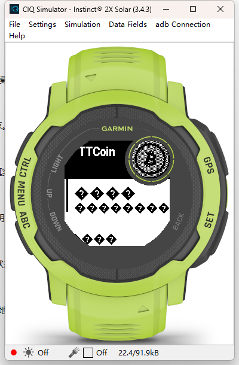
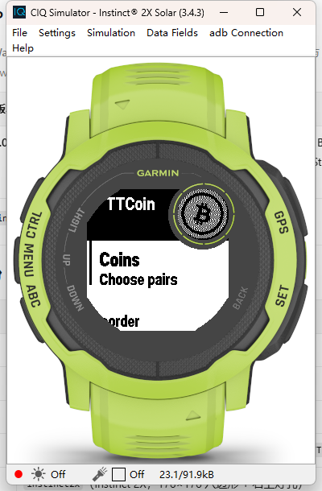

# TTCoin_APP 发布文档

> Connect IQ **Watch App**（`type="watch-app"`）：从应用列表进入，显示价格与 24h 涨跌，Start 呼出菜单选币 / 排序，Up/Down 翻页。

| 项目 | 版本 | 发布日期 | 应用 id | 发布形态 | 状态 |
| --- | --- | --- | --- | --- | --- |
| TTCoin_APP | **1.0.3** | 2026-11-09 | `1d087cf1-27ae-4c64-a653-42e113497d07` | 侧载 `.prg` / Beta / Connect IQ Store（Apps 分类） | **构建通过 · 模拟器验收通过（英文）· 中文待真机** |

前置依赖：`TTCoin_API` 已上线（第 6 节第 1 步会先验服务端）。

---

## 1. 版本与身份

| 项 | 值 |
| --- | --- |
| 版本 | 1.0.3（1.0.2 许可证改为 PolyForm Noncommercial；**1.0.3 主界面新增顶部时钟**） |
| 类型 | `watch-app`（应用列表入口，不是小工具） |
| 手表上的名字 | **TTCoin**（`resources/strings/strings.xml`） |
| 入口类 | `TTCoinApp`（`AppBase.getInitialView()` → `[TTCoinView, TTCoinDelegate]`） |
| 支持机型 | `instinct2x`（Instinct 2X，176×176 八边形 + 右上灯孔） |
| 最低 API | 3.4.0（`minApiLevel`） |
| 权限 | `Communications` |
| 语言 | `eng` + `zhs`（基础语言英文在 `resources/`，中文在 `resources-zhs/`，见 §2.1） |
| 产物 | `bin/TTCoin_APP.prg`（112,828 字节，2026-11-08 12:16 构建） |
| 服务端 | `https://api.example.com/ttcoin/api/coin.php` |

> Connect IQ 的 `manifest.xml` 里**没有版本字段**——商店版本号在开发者后台按次填写；侧载安装不带版本元数据。所以版本只存在于本文档与产物归档名（建议 `TTCoin_APP-1.0.0.prg`）。

**与 Widget 版的边界**：两个项目必须使用**不同 app id**。手表按 id 认应用，同 id 后装会顶掉先装（连 `type` 一起改），现象是"两个都装了只剩一个"。当前 APP `1d087cf1-…`、Widget `e8dab0f9-…`，已用字节级校验确认互不包含（第 5.2 节）。

## 2. 本次交付内容

| 能力 | 说明 |
| --- | --- |
| 默认顺序跟接口 | 用户没动过任何勾选时，显示**接口返回顺序的前 3 项**（`DEFAULT_COUNT`）；服务端调顺序 / 加币种，表上自动跟随 |
| 手表端选币 / 排序 | Start → 菜单勾选、上移下移，立即生效并写入 `Properties` / `Storage` |
| 轮播 + 手动翻页 | 每屏 2 个币种（`PAGE_ROWS`），超过 2 个每 8 秒翻页，Up/Down 手动翻 |
| 涨跌箭头 | 手绘三角形（`fillPolygon`），不依赖字体，不会缺字 |
| 失败回退 | 接口失败先按编译期 `DEFAULT_API` 重试一次；两次都失败才报错，并用 `Storage["ttcoin_api_bad"]` 记住坏地址 |
| 响应码可见 | `- Offline 403 -` / `No Net -104`，区分"连不上 / 被拒 / 结构错" |
| 45s 看门狗 | `REQUEST_TIMEOUT_MS`，上一轮请求未回时不再叠加新请求 |
| 界面移除表端改地址 | 原 `TextPicker` 输入项与 `TTCoinApiDelegate` 已删除（属性值跨安装持久化，表端改地址会长期钉死旧值） |
| 双语界面（1.0.1） | 菜单文案全部资源化，跟随设备系统语言：`zhs` → 中文，其它 → 英文。同一份 `.prg` 在中文固件与国际版固件上都能读 |
| 菜单去掉 ↑ / ↓ | 「上移 ↑」「下移 ↓」改为纯文字：Garmin 内建字体没有 U+2191/U+2193，原先画成空心菱形，两条看起来一样 |

### 2.1 双语资源怎么组织的（1.0.1）

| 层 | 位置 | 作用 |
| --- | --- | --- |
| 基础语言（英文） | `resources/strings/strings.xml` | **兜底**：任何没有对应翻译的语言都用这份。国际版固件只有 Roboto，这里必须保持纯 ASCII |
| 简体中文 | `resources-zhs/strings/strings.xml` | 设备语言为 `zhs` 时加载。id 与基础语言一一对应 |
| 取用 | `source/TTCoinText.mc` → `TTCoinText.get(Rez.Strings.Xxx, "fallback")` | 统一入口，取不到资源时返回兜底串，不会因 `null` 触发 strict 类型错误 |
| 语言声明 | `manifest.xml` 的 `<iq:languages>` = `eng` + `zhs` | 商店侧"支持语言"元数据；**不影响运行时选择**，运行时只看资源目录限定符 |

两条实测结论（都是本轮验证出来的）：

1. `monkey.jungle` 里写了 `base.resourcePath = resources` 也**不影响** `resources-zhs` 被扫描——编译器按"基名 + 语言限定符"自己找到了它（产物里能搜到中文 UTF-8 字节）；
2. 同一份 `.prg` 里中英文同时在（`选择币种` 各命中 1 次、`Choose pairs` 命中 2 次），说明两种语言是**各自独立的资源条目**，不是互相覆盖。

新增文案只需改两个 xml；两处 id 必须同名，漏了中文会静默回落成英文（不会报错）。

## 3. 发布就绪评估

| 维度 | 结论 | 依据 |
| --- | --- | --- |
| 编译 | ✅ | SDK 9.2.0 `monkeyc -l 2` 通过（0 error / 8 条历史 warning），产物 112,828 字节，晚于全部源码 |
| 资源完整性 | ✅ | `properties.xml` / `settings.xml` / `strings.xml` ×2（基础 + zhs）/ `launcher_icon.png` 均在；产物字节级校验：中英文两套文案同时存在，旧 `↑/↓` 字符 0 命中 |
| 与接口契约一致 | ✅ | 只读 `symbol` / `base` / `price` / `change`，全部按字符串处理；`1000*SHIB` 靠 `base` 匹配，不会被前缀打断 |
| 与 Widget 共存 | ✅ | 两 id 不同，产物内嵌 UUID 交叉验证为 0 命中 |
| 真机 | ✅ 模拟器已验收（2026-11-08，见 §6.1） / ⏳ 真实手表待确认 | SDK 9.2.0 模拟器 `Instinct 2X Solar (3.4.3)` 实跑：装载成功、拉通真实行情、`- Cache -` → `- Coin -`、页码 `1/2 → 2/2`、Start 菜单可弹出并显示**英文**条目 |
| 中文分支 | ⏳ 只能真机验 | 模拟器设备是国际版字体集、也**没有切语言的入口**，`resources-zhs` 的运行时命中只能在中文固件手表上看 |
| 回滚 | ✅ | 同 id 覆盖安装上一版 `.prg` 即可 |

**判定：可发布使用。** 模拟器上功能闭环已跑通；真实手表的差异只在"是否中文固件"（见 §8 第 6 条）。

## 4. 构建

```bash
# SDK 9.2.0；-y 必须给开发者密钥，否则只能出模拟器包
monkeyc.bat -f monkey.jungle -o bin/TTCoin_APP.prg \
  -y <path-to-developer_key> \
  -d instinct2x -w -l 2
```

产物三件套：`TTCoin_APP.prg`（待安装）、`TTCoin_APP.prg.debug.xml`（调试符号）、`TTCoin_APP-settings.json`（设置快照）。

## 5. 发布步骤

### 5.1 侧载（自用，当前主路径）

```bash
monkeydo.bat bin/TTCoin_APP.prg instinct2x      # 手表已连接并处于 MTP 模式
```

或手动拷贝到手表的 `GARMIN\APPS\`。

### 5.2 发布门禁：产物身份核对

```bash
python - <<'EOF'
ids={'APP':'1d087cf1-27ae-4c64-a653-42e113497d07',
     'Widget':'e8dab0f9-d9a8-4ef5-8bab-fd05bcf135f5'}
for k,f in {'APP':'TTCoin_APP/bin/TTCoin_APP.prg',
            'Widget':'TTCoin_Widget/bin/TTCoin_Widget.prg'}.items():
    d=open(f,'rb').read()
    print(k, {n:d.count(bytes.fromhex(u.replace('-',''))) for n,u in ids.items()})
EOF
```

期望：`APP` 那一行 `{'APP': 1, 'Widget': 0}`，`Widget` 那行相反。任一行出现 `2` 或交叉命中，说明 manifest 被改错，**不要发**。

### 5.3 Connect IQ Store / Beta（可选）

- 商店分类：**Apps**（Widget 是另一个分类，另一个条目）；
- 导出 `.iq`：命令面板 `Monkey C: Export Project`；
- 审核约 72 小时；Beta 不上架但本账号可下载，**且能出现手机端设置页**（侧载不会）；
- 侧载版本在 Garmin Connect「我的应用」里不出现，`settings.xml` 定义的设置页也就不会渲染——这是 Garmin 的设计，不是缺陷。

## 6. 发布后验收（真机，5 步）

| # | 操作 | 期望 |
| --- | --- | --- |
| 1 | 手机浏览器打开接口地址 | 返回 JSON 数组（先排除服务端问题） |
| 2 | 应用列表进入 **TTCoin** | 先出上次缓存，副标题 `- Cache -`，数秒内变 `- Coin -` |
| 3 | 观察首屏 3 项 | 与接口返回顺序前 3 项一致（BTC / ETH / DOGE，或服务端改过的顺序） |
| 4 | Start → 勾选 SHIB 并上移 | 菜单文案是**中文**（设备语言为中文时）、**没有方块**；「上移 / 下移」两个条目文字不同、能分辨；修改后立即重绘，退出重进仍保持 |
| 5 | Up/Down | 两页之间切换，页码 `1/2` 正确 |

**1.0.1 新增必须看的一条**：把系统语言切成英文再进一次 Start 菜单，条目应变成 `Coins` / `Reorder` 而不是方块——这条同时验证了 `resources/` 那套英文确实被选中（模拟器上已验证英文这一侧，见 §6.1）。

异常对照：`- Offline 403 -` → CDN/防火墙拒绝；`- Offline -104` → 连不上；`No Data` → 返回体不是数组；`- Offline -1 -` → 本机 45s 看门狗超时。

### 6.1 模拟器验收记录（2026-11-08 12:00 前后）

环境：Connect IQ SDK **9.2.0**，模拟器设备 `Instinct® 2X Solar (3.4.3)`，`monkeydo TTCoin_APP.prg instinct2x`（退出码 0）。

| 观察点 | 实测结果 |
| --- | --- |
| 首帧 | `- Cache -` · 页码 `1/2` · `BTC 75853.06 ▼0.076%` / `ETH 2236.87 ▼0.293%` |
| 约 12s 后 | **已切到 `- Coin -`** · 页码 `2/2` · `DOGE 0.0713 ▼0.931%`（本轮修复目标：不再停在 `- Cache -`） |
| 默认 3 项 | BTC / ETH / DOGE —— 与接口顺序前 3 项一致 |
| 翻页 | 8 秒自动翻到第 2 页，`1/2 → 2/2` 正确 |
| 服务端对照 | 同一时段 `?type=app` 返回 `BTC 75882`、`ETH 2237.49`、`DOGE 0.0713` —— 量级、小数位、涨跌方向都对得上（价格本身随时间变动） |
| Start 菜单 | 能弹出，标题 `TTCoin` 正常；**条目显示为缺字方块**（当时文案硬编码中文，模拟器字体无中文字形）——1.0.1 已修 |

| 截图 | 说明 |
| --- | --- |
|  | 进入时 `- Cache -`，第 1 页 2 个币种 |
|  | 切到 `- Coin -`，已翻到第 2 页 |
|  | 1.0.0 的 Start 菜单：拉丁标题正常，硬编码中文缺字（**已修**） |

### 6.2 双语资源化复测（2026-11-08 12:16 构建后）

| 观察点 | 实测结果 |
| --- | --- |
| 编译 | SDK 9.2.0，0 error / 8 warning（均为历史遗留的类型宽化提示） |
| 产物字节校验 | `Choose pairs` ×2、`Current order` ×2、`Move Up` ×2；`选择币种` / `排序（当前顺序）` / `上移` 各 ×1；旧箭头 `↑` **0 命中** |
| 运行（模拟器语言 = 英文） | Start 菜单标题 `TTCoin`、条目 **`Coins` / `Choose pairs`**、第二项 `…rder`（`Reorder`）——英文资源被正确选中，无方块 |
| 中文分支 | 模拟器设备字体集只有 Roboto，且 Settings 菜单里没有语言切换项，无法在模拟器上构造 `zhs` 环境 → 留给真机（§6 第 4 步） |

| 截图 | 说明 |
| --- | --- |
|  | 1.0.1 的 Start 菜单：条目已是英文 `Coins` / `Choose pairs`（右侧圆环是模拟器叠加的灯孔示意，不是绘制内容） |

## 7. 回滚

1. 同 id 覆盖安装上一版 `.prg`（保留历史产物，建议按版本子目录归档）；
2. 若装坏无法启动：删掉手表上的 TTCoin 再重装；
3. 属性 `apiUrl` 跨安装保留（`properties.xml` 只是首装初值）——若回滚到不含自动回退逻辑的旧版，务必确认属性里不是废弃地址；
4. 本地缓存 key 为 `ttcoin_cache_v3`，旧版读到会按结构不匹配丢弃，不影响启动。

## 8. 已知限制（1.0.1 范围外）

- **侧载没有手机端设置页**（只有 Start 菜单：选币、排序）；
- **不支持手表端改接口地址**（本轮明确移除）；换地址 = 改 `properties.xml` 重编译，或走商店/Beta 用手机设置；
- **一屏 2 个币种**：灯孔吃掉右上角后整行宽只剩 `y 76..162`，第三组放不下；
- **只适配 Instinct 2X**：换机型需重测可绘区域与字号；
- **缓存无过期判断**：隔几天打开也会先显示旧价，靠 `- Cache -` 提示；
- **菜单语言跟随设备系统语言，不能单独指定**：1.0.1 起文案走资源表，中文固件显示中文、英文固件显示英文。如果想把中文手表也切成英文界面，目前只能改系统语言（或加一个设置开关，属后续需求）；
- **行情页的 `- Coin -` / `- Cache -` / `No Net` 等状态词仍是英文**：这些串的宽度都按像素量过八边形可用宽度，翻译成中文要重新量版，收益只有几个词，本版不做；
- **国际版固件（`006-B4394-00`）无法显示中文**：这是固件字体限制，不是代码问题——但 1.0.1 起该固件会自动取英文文案，菜单可正常阅读（1.0.0 的方块问题已消除）。

## 9. 风险登记

| 编号 | 风险 | 影响 | 现状与缓解 |
| --- | --- | --- | --- |
| R1 | 真实手表未验证 | 模拟器已通过，但按键手感、屏幕实际亮度、连线转发仍可能不同 | 第 6 节 5 步作为真机门禁；模拟器结论见 §6.1 |
| R1b | 中文分支未在真机确认 | `resources-zhs` 的运行时命中只能靠中文固件手表验证；万一不命中会退回英文（菜单仍可读，不会方块） | 1.0.1 已做双语资源化并移除 `↑/↓`；§6 第 4 步为验收点。即便中文未命中，最坏结果也只是显示英文 |
| R6 | 新增文案忘同步两套 xml | 缺哪条就静默回落英文 | 两个文件必须同 id；发布前跑一次产物字节校验（见 §6.2 第 2 行） |
| R2 | `Properties` 跨安装持久化 | 旧地址长期覆盖新默认值 | 已加"失败重试 `DEFAULT_API`" + `Storage["ttcoin_api_bad"]`；仍建议升级后首启确认一次 |
| R3 | 接口慢导致长时间 `- Cache -` | 看起来像不刷新 | 服务端已改异步刷新；本轮未在真机确认切换时延 |
| R4 | 两个包 id 冲突 | 只剩一个入口 | 5.2 节字节校验列为门禁 |
| R5 | 内存紧张设备 | 大数组解析失败 | 数据量固定（≤11 项），已按字符串处理，未做分块 |

## 10. 评估发现的文档不一致（已修正）

1. ✅ `README.md` 首句原写"一个只有 100 多行的 Connect IQ **Widget**"，English 段同样写 widget —— 本项目已是 `watch-app`、1200+ 行，说明与产品不符。已改为 Watch App 表述；
2. 复核结论：「状态可见」表与「手机端设置仅商店安装可用」的标注**本来就是对的**，此前的疑问撤回，无需改动。

## 11. 变更记录

| 日期 | 版本 | 内容 |
| --- | --- | --- |
| 2026-11-08 | 1.0.0 | 默认顺序与默认前 3 项改为跟随接口；移除表端改接口地址；失败重试编译期默认地址；状态栏显示响应码；45s 看门狗；app id 与 Widget 分离 |
| 2026-11-08 | 1.0.1 | 菜单文案全部移入资源表，新增 `resources-zhs/` 简体中文与 `TTCoinText` 取用入口，`manifest` 声明 `eng` + `zhs`；「上移 ↑ / 下移 ↓」去掉箭头字符（内建字体缺字）；`settings.xml` 的 `ApiUrlInvalid` 补英文 |
| 2026-11-08 | 1.0.2 | 许可证由 MIT 改为 **PolyForm Noncommercial License 1.0.0**：仅限非商业用途，商用须另行取得书面授权；`LICENSE` 重写并附 `Required Notice`，README 增补「可以 / 不可以」对照；**无代码与资源改动，`.prg` 无需重编** |
| 2026-11-09 | 1.0.3 | 副标题上方新增当前时间（24 小时制，如 `14:25`），与 `- Coin -` 同轴居中；走时用独立 1 秒定时器，**只在换分钟时 `requestUpdate`**，`onHide` 停表；版式取 `CLOCK_Y=8` + `FONT_TINY`，避免蹭到左上角八边形斜边（`x+y=39.6`） |
